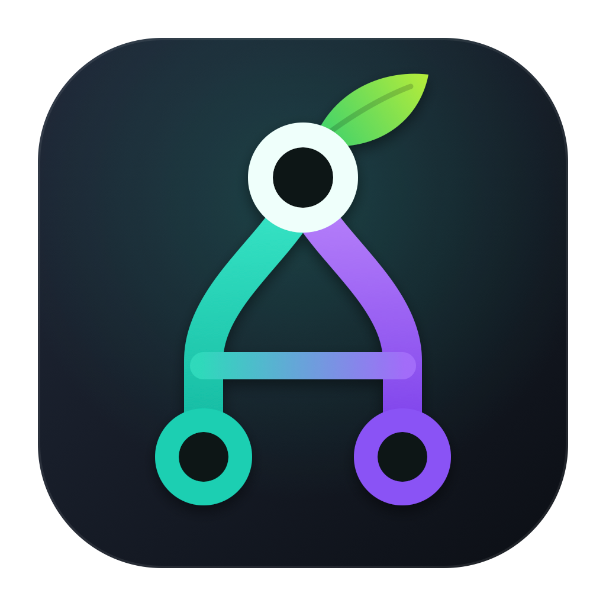
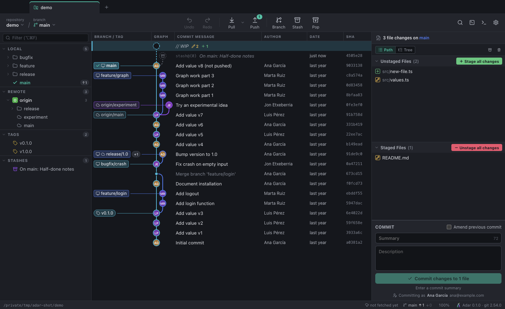

<p align="center">
  
</p>

<h1 align="center">Adar</h1>

<p align="center">
  <b>A fast, visual Git client for every repository — public or private.</b><br>
  GitHub, GitLab, Bitbucket, Azure DevOps or your own server.
</p>

<p align="center">
  <a href="https://github.com/mikelgarciaurbina/adar/releases/latest"></a>
  <a href="https://github.com/mikelgarciaurbina/adar/actions/workflows/ci.yml"></a>
  <a href="LICENSE"></a>
</p>

<p align="center"><a href="https://mikelgarciaurbina.github.io/adar/">Website</a> · <a href="https://mikelgarciaurbina.github.io/adar/roadmap.html">Roadmap</a> · <a href="README.es.md">Leer en castellano</a></p>

> *Adar* means **branch** in Basque (euskara).



Adar drives the `git` already installed on your machine, so it works with exactly the same credentials you use in
the terminal — SSH keys, the macOS Keychain, `gh auth`, credential helpers, Git LFS and hooks. No accounts, no
proxy servers, no restrictions on which repositories you can open. When git needs a username, token or SSH
passphrase, Adar asks for it in a dialog and git stores it with your usual credential helper.

Adar's UX is inspired by GitKraken. It is an independent, clean-room project: it contains no GitKraken code, assets or
branding and is not affiliated with GitKraken or Axosoft.

## Features

- **Commit graph** with coloured lanes, avatars, branch/tag/remote labels, a `// WIP` node and stashes; search by
  message, author, SHA, content or path; smooth scrolling through tens of thousands of commits.
- **Drag & drop** a branch onto another to merge, rebase, fast-forward or push.
- **Left panel**: local and remote branches grouped in folders, tags, stashes and submodules, with filtering,
  ahead/behind counters and hide/solo branches in the graph.
- **Staging** by file, hunk or individual lines; discard changes; ignore files.
- **Commits**: summary + description, amend, "stage all & commit", pre-filled merge messages, and **edit the message of
  any commit on your branch** in place (with a warning and a force-push shortcut when it was already pushed).
- **Diffs** unified or side by side, changed hunks or the full file, syntax highlighting and intra-line changes;
  image diffs; file history and blame.
- **Merge conflict tool** (A / B / editable output) and a banner to continue, skip or abort merges, rebases,
  cherry-picks and reverts.
- **Visual interactive rebase**: pick, reword, edit, squash, fixup, drop and drag to reorder.
- **Remotes**: fetch (also in the background), pull (ff-only / merge / rebase), push with upstream, force-push with lease,
  remote management, clone with progress.
- **Undo / redo** for git actions (checkout, commits, branches, tags, resets, stashes…).
- **Tab groups**: keep a project's repositories (say api, app and landing) together under a named, coloured chip;
  collapse them, and reopen the whole group in one click from the welcome screen, the **+** menu or the palette.
- **Command palette** (⌘P), built-in **git console** (⌃\`), tabs for several repositories, dark and light themes,
  keyboard shortcuts.
- **In-app updates** from GitHub Releases (*Adar → Check for Updates…*).
- **Safe by default**: destructive actions ask first and can be undone, and repositories whose configuration would make
  git run commands (hooks, `core.fsmonitor`, credential helpers…) are only opened after you trust them.

## Download

Grab the latest `.dmg` from the [Releases page](https://github.com/mikelgarciaurbina/adar/releases/latest).
Adar is built for **Apple Silicon Macs** (M1 and newer); Intel Macs are not supported.

Open the `.dmg` and drag **Adar** to **Applications**. The app is not signed with an Apple Developer ID yet, so
macOS may say it "is damaged" the first time (right-click → Open no longer bypasses this on macOS 15 and later).
Run this once in Terminal, then open Adar normally:

```bash
xattr -dr com.apple.quarantine /Applications/Adar.app
```

After that, Adar keeps itself up to date (*Adar → Check for Updates…*).

Requirements: a recent macOS on Apple Silicon and Git 2.26+ (`xcode-select --install` or `brew install git`). Linux and Windows are not
supported yet (the code is mostly portable — contributions welcome).

## Command line

Open a repository in Adar from your terminal, like `code .` or GitKraken's `gk`:

```bash
adar              # the repository of the current folder
adar ~/code/app   # any folder inside a repository
adar ~/code/shop  # a folder holding several repositories: opens them as a tab group
```

Install the command once from **Adar → Install Command Line Tool…** (or *Settings → Integrations*). It links
`adar` into `/opt/homebrew/bin` or `/usr/local/bin` (asking for your password only if neither is writable). If Adar is
already running the repository opens in a new tab. You can also drop a folder on Adar's Dock icon.

## Keyboard shortcuts

| Action | Shortcut |
| --- | --- |
| Command palette | ⌘P |
| Find commit | ⌘F |
| Open / clone repository | ⌘O / ⇧⌘N |
| Fetch / pull / push | ⇧⌘F / ⇧⌘↓ / ⇧⌘↑ |
| Create branch | ⌘B |
| Stash / pop | ⇧⌘S / ⌥⌘S |
| Stage all | ⇧⌘A |
| Commit (from the message box) | ⌘↩ |
| Undo / redo git action | ⌘Z / ⇧⌘Z |
| Toggle left / right panel | ⌘J / ⌘K |
| Next / previous change in a diff | N / P or ⌥↓ / ⌥↑ |
| Next / previous file in a diff | ] / [ |
| Git console | ⌃\` |

## Development

```bash
git clone https://github.com/mikelgarciaurbina/adar.git
cd adar
npm install
npm run dev        # desktop app with hot reload
npm run web        # same UI in a browser: open the http://127.0.0.1:5898/#t=… URL it prints
npm run typecheck
npm test           # unit + integration tests against temporary git repositories
npm run dist       # build release/Adar-<version>-arm64.dmg and .zip
```

Stack: Electron, React 19, TypeScript, zustand and Vite (electron-vite). The architecture, conventions and testing tools
(including scripted end-to-end runs of the real app) are documented in [AGENTS.md](AGENTS.md) — read it before sending
a pull request. See [CONTRIBUTING.md](CONTRIBUTING.md) for the workflow.

### Releasing

Pushing a `v*` tag builds the macOS app on GitHub Actions and publishes a release; installed copies pick it up through
the in-app updater:

```bash
npm version 0.3.1   # bumps package.json and creates the v0.3.1 tag
git push origin main --tags
```

## Roadmap

Localization (English, Spanish, Basque), pull-request integrations, signed builds, worktrees, Linux/Windows and
more — see [ROADMAP.md](ROADMAP.md).

## Contributing

Bug reports, ideas and pull requests are welcome — please read [CONTRIBUTING.md](CONTRIBUTING.md) and our
[Code of Conduct](CODE_OF_CONDUCT.md). Security issues: see [SECURITY.md](SECURITY.md).

## License

[MIT](LICENSE) © Mikel García
